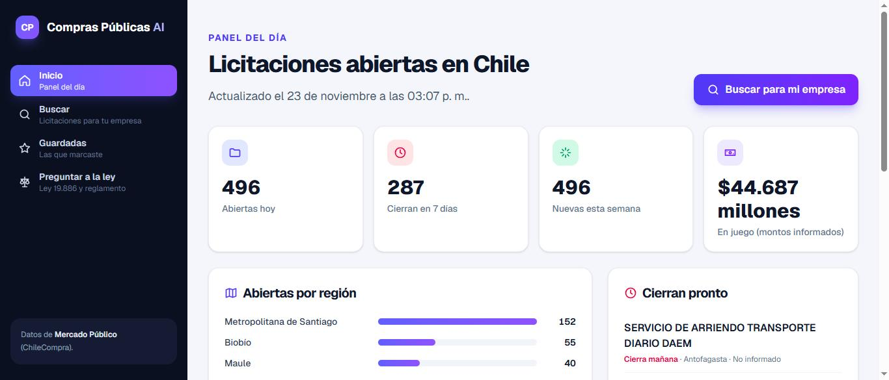
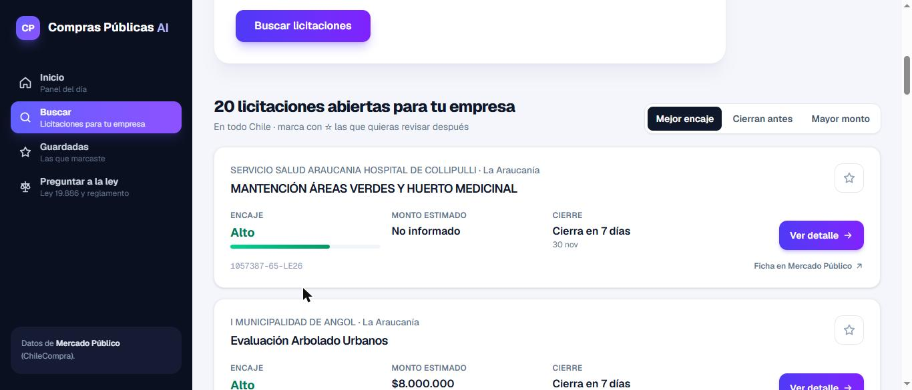
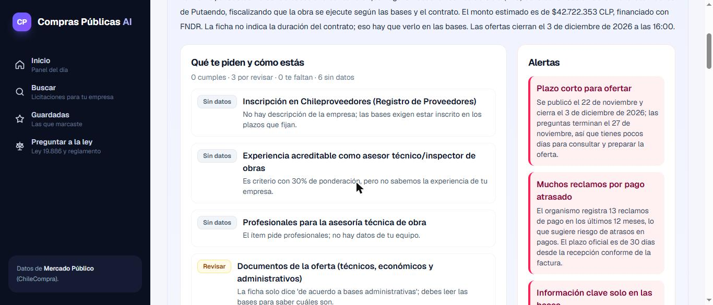
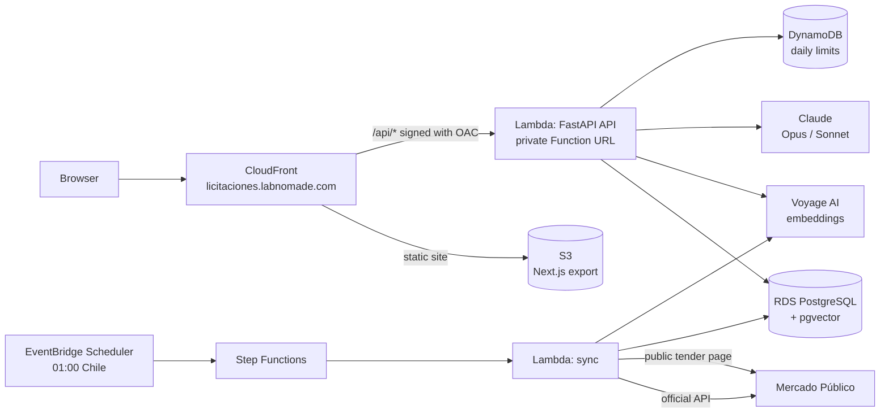

# Compras Públicas AI

**AI copilot for small businesses that sell to the Chilean government.** Describe your company in plain words and it finds the open public tenders (Mercado Público / ChileCompra) that fit you, explains what each one requires, flags the risks and cites the procurement law that applies.

**Live demo: [licitaciones.labnomade.com](https://licitaciones.labnomade.com)** (UI in Spanish, built for the Chilean market)

## What it does

| | |
|---|---|
| **Semantic tender search** | "We maintain green areas and prune trees" finds *"urban tree assessment"* or *"lawn and weed removal"*: matching by meaning, not keywords, across ~5,000 open tenders, filtered by region and contract size. |
| **Tender detail** | Everything that matters before bidding, instantly and at no cost: evaluation criteria and weights, required documents, guarantees, payment terms, key dates, the full clauses and the buyer's history of late-payment complaints. |
| **AI analysis on demand** | One click: a plain-language summary, how to score points, each requirement marked *meets / review / missing* against your company, concrete alerts and the law articles that apply. |
| **Ask the law** | Chat over Law 19.886 and its regulation with article-level citations. |

## Architecture

- **Nightly sync** (Step Functions, one batch at a time): pulls the list of open tenders, fetches only what is new or changed, reads each tender's public page for the data the official API does not provide (criteria, guarantees, documents, clauses) and embeds new tenders. Respectful by design: one request at a time with pauses, a hard cap per run and night-time only, as ChileCompra asks.
- **Same domain for site and API**: CloudFront serves the static site from a private S3 bucket and signs every `/api/*` request to the Lambda (Origin Access Control). The Lambda URL itself rejects unsigned calls.

## Engineering highlights

- **RAG built and measured without a framework.** Law articles chunked and embedded with Voyage (`voyage-4`) in pgvector; multi-query retrieval (the original question plus a Claude Haiku rewrite) fused with reciprocal rank fusion. Evaluated against a hand-written question set: **87 % retrieval hit rate**; answers judged by an LLM: **33/36 faithful to the cited articles, 82/88 key points covered**.
- **Structured outputs for the tender analysis.** One Claude Sonnet call with a Pydantic schema (`client.beta.messages.parse`), server-side refusal fallback, and explicit rules: use only the provided data, mark unknowns as "no data", cite only retrieved articles.
- **Cost control as a feature.** Free detail first, paid AI only on demand; analyses cached per company and tender version (a repeat costs $0); per-person and global daily limits enforced with atomic DynamoDB counters; embeddings computed once per text (content hash). Typical cost: **~US$0.05 per analysis, ~US$0.07 per law question**; search uses only embeddings (~100 tokens).
- **Prompt-injection hardening.** Tender text and company descriptions are treated as data, never instructions; an attack eval with 10 direct and indirect injection cases passes **10/10**.
- **Least privilege everywhere.** The API's database user can only read, plus insert into its own cache table; the sync job has its own user and secret; the Lambda is private behind CloudFront; secrets live in Secrets Manager.
- **Observability and evals.** Traces in LangSmith; eval scripts for retrieval, answers, the agent and attacks (`backend/eval/`); **121 automated tests** (no network, no paid calls) running in GitHub Actions.

## Tech stack

- **Backend:** Python 3.12 · FastAPI · Pydantic · PostgreSQL + pgvector · Anthropic SDK (Claude Opus / Sonnet) · LangGraph (tool-calling agent) · Voyage AI · BeautifulSoup · pytest · ruff
- **Frontend:** Next.js 16 (static export) · React 19 · TypeScript · Tailwind CSS 4
- **AWS:** Lambda (container images) · RDS · S3 · CloudFront + OAC · ACM · Step Functions · EventBridge Scheduler · DynamoDB · Secrets Manager · CloudWatch alarms + SNS
- **Tooling:** Docker · GitHub Actions · LangSmith

## Code samples

The full source is private (this is an active product). A few representative pieces:

| File | What it shows |
|---|---|
| [`snippets/daily_limits_dynamodb.py`](snippets/daily_limits_dynamodb.py) | Per-person and global daily limits with **atomic conditional counters** in DynamoDB (a Lambda has no shared memory), hashed IPs with a secret salt, checked before any paid model call. |
| [`snippets/nightly_sync_plan.py`](snippets/nightly_sync_plan.py) | The nightly sync planner as a **pure function**: compares the official list of ~5,000 open tenders with the database and fetches only what is new, changed, closed or missing its detail, under per-night caps. Unit-tested without database or API. |
| [`snippets/cloudfront_routes.js`](snippets/cloudfront_routes.js) | CloudFront Function that routes `/api/*` to the private Lambda and serves the static Next.js export from S3 on a single domain. |

Comments in the code are in Spanish (the product and its team are Chilean).

## Source code

The application code (backend, data pipeline, evals, frontend and **121 automated tests** running in GitHub Actions) lives in a private repository. **Access is available on request for hiring processes**: reach me through the links below.

## Roadmap

- Calibrate the match threshold with the full set of open tenders
- Optional upload of tender PDFs for deeper analysis
- Alerts by email when a new tender fits your company
- Infrastructure as code

## Data and disclaimer

Tender data comes from [Mercado Público](https://www.mercadopublico.cl) (ChileCompra) through its public API and public tender pages, citing the source as its terms of use require; no personal data of officials is stored. This is a decision-support tool, not legal advice: always read the official tender documents before bidding.

---

Built by **Alejandro Ordenes** · [aordenes.com](https://aordenes.com) · [LinkedIn](https://www.linkedin.com/in/alejandro-ordenes/)
